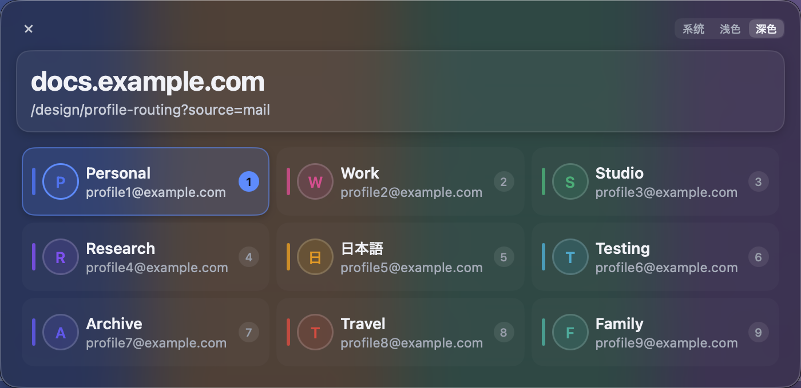
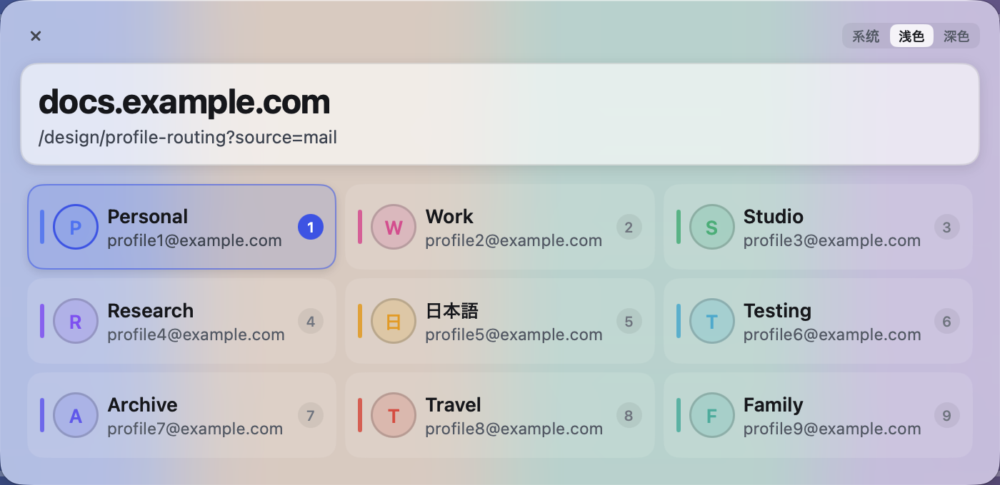

# Chrome Profile Router

用 Go 与 [MyGo](https://github.com/egoist/mygo) 写的链接分流小工具：从外部打开链接时，先选一个 Chrome Profile，再把链接交给它。macOS 是主线，Linux 与 Windows 共用同一套流程。

<p align="center">
  
  <br />
  <br />
  
</p>

## 它做什么

在多个 Chrome Profile 之间切换时，从微信、飞书、Slack 或终端点开的链接容易落进不合适的账号，比如公司内网用私人身份打开，私人链接掉进工作账号。

设为默认浏览器后，链接先到这里：顶部是目标地址，下面列出本机已有的 Chrome Profile，选哪个就用哪个打开，处理完就退出。

- 身份列表直接读 Chrome 的本地配置，名称、邮箱和头像都是现成的，不用维护清单
- 选完身份后调起对应 Profile 的 Chrome 窗口，队列空了才退出，不常驻后台
- 启动失败不会丢链接，可以再选一次
- 跟随系统外观与减少动态效果，也可以在设置里单独调

## 支持情况

macOS 12 及以上是主线：原生磨砂材质，默认浏览器设置里选中即生效。

Linux amd64 已实测：在隔离的 Debian 13 + X11 环境里用官方 Chrome 做过端到端验证（发现 Profile、选身份后进入正确 Profile、队列依次交付、失败可重试、同一时间只出一个面板）。还没在真实桌面长期使用，界面是实色表面（GTK 没有原生磨砂）。arm64 只构建过，没有实际运行记录。

Windows 为实验支持：已有 amd64/arm64 安装包，amd64 在 Wine 通过功能测试；原生 Windows 的默认应用、单实例和显示效果尚未验证。Wine 中还观察到中文渲染与第二实例转发问题，见[平台说明](docs/platforms.md)。

需要本机已装 Chrome Stable 并至少创建过一个 Profile。构建需要 Go 1.27.3 及以上。

## 安装

macOS：

```bash
git clone https://github.com/chinnsenn/chrome-profile-router.git
cd chrome-profile-router
./build.sh
```

`./build.sh` 按本机架构编译，先在目标卷暂存并校验签名，再替换 `/Applications/Chrome Profile Router.app`，替换失败时保留旧版本。

只打包、不安装：

```bash
go run github.com/egoist/mygo/cmd/mygo build -skip-dmg -platform darwin/arm64,darwin/amd64
```

Linux 与 Windows 的安装步骤见 [docs/platforms.md](docs/platforms.md)：两者都只把自己登记成 http/https 的候选，默认浏览器仍由你在系统设置里选。

打好的安装包在 [Releases](https://github.com/chinnsenn/chrome-profile-router/releases) 页下载。macOS 的 DMG 没有 Developer ID、未公证，首次打开可能要在「隐私与安全性」里手动允许；Windows 包仍是实验支持（原生 Windows 尚未验证）。

## 使用

先把 Chrome Profile Router 设为默认浏览器：macOS 在系统设置的「默认网页浏览器」里选，Linux/Windows 在各自的默认应用设置里选。之后从任何应用点开 http 或 https 链接，都会先出现选择菜单。

选好身份后，链接交给对应的 Chrome Profile 打开。队列里的链接都成功交付、没有剩余时，菜单自己关闭；启动失败会留在菜单上并说明原因，可以再选一次。

| 操作 | macOS | Linux / Windows |
| --- | --- | --- |
| 用指定身份打开链接 | 数字键 1 到 9，或方向键移动后回车 | 同左 |
| 查看完整身份信息 | 空格 | 空格 |
| 复制当前链接 | `⌘C` 或地址卡右侧的复制按钮 | `Ctrl+C` 或地址卡右侧的复制按钮 |
| 打开设置 | `⌘,` 或右上角的设置图标 | `Ctrl+,` 或右上角的设置图标 |
| 关闭 | `Esc`、左上角关闭按钮、`⌘Q` | `Esc`、左上角关闭按钮、`Ctrl+Q` |

设置面板在同一个窗口里替换身份列表，可以调背景与阅读面浓度、磨砂材质、几个卡片动效开关，以及减少动态效果。改动即时生效，关闭面板时写入配置文件。`Esc` 先关面板，面板关掉后再按才退出应用。

想换回 Chrome、Safari 或其他浏览器时，回到同一处默认浏览器设置选回去就行。

## 开发

```bash
go test ./...
go test -race ./...
go vet ./...
bash -n build.sh
```

交叉编译检查（不需要本机装对应系统）：

```bash
GOOS=linux GOARCH=amd64 CGO_ENABLED=0 go build ./...
GOOS=windows GOARCH=amd64 CGO_ENABLED=0 go build ./...
```

CI 在 macOS、Linux、Windows 上分别跑测试与 vet，并打包各平台产物；只有 push `v*` 标签才会创建 Release。版本号只有 `mygo.json` 一处，标签与发布的规则、资产清单见 [docs/releasing.md](docs/releasing.md)。

选中卡流彩与柔光的参数出处见 [docs/visual-design.md](docs/visual-design.md)，平台差异与未验证项见 [docs/platforms.md](docs/platforms.md)。

## License

MIT
